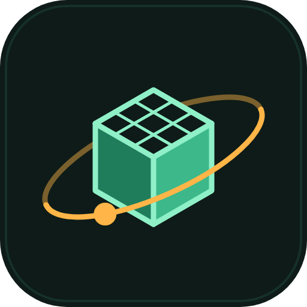

<p align="center">
  
</p>

<h1 align="center">3D Website Boilerplate Designer</h1>

<p align="center">
  An agent skill that scaffolds working 3D websites with Three.js or React Three Fiber, then helps you customize them, load real assets, and make them run well on phones.
</p>

[Click! This is an example](marren-chair-configurator.html)

---

## What it does

Ask your agent for a 3D website and this skill generates a real, installable [Vite](https://vitejs.dev) project instead of pasting a code snippet. Every combination of stack and pattern has been installed and built successfully, so you start from code that runs.

After the project exists, the skill walks you through the customization work that matters for that pattern, brings in your own 3D models and textures, and runs a performance and accessibility pass before you call the site finished.

**You do not need to know Three.js.** Describe what you want ("a rotating logo on my homepage", "the camera moves through scenes as you scroll") and the skill picks the matching pattern.

## Quick start

1. Install the skill from its [Agensi listing](https://www.agensi.io/skills/3d-website-boilerplate-designer) into your agent's skills folder. For Claude Code that is `~/.claude/skills/` for all projects, or `.claude/skills/` inside one project. Other agents use their own skills folder.
2. Ask for what you want in plain language, for example:
   > Build me a 3D landing page with a product I can rotate and recolor.
3. The skill confirms the stack and pattern, scaffolds the project, and runs it:
   ```bash
   cd your-project
   npm install
   npm run dev
   ```

Requirements: Node.js 18 or newer and npm.

## The four patterns

| Pattern | What you get | Good for |
|---|---|---|
| `hero-scene` | A full-screen 3D object that rotates gently, with orbit controls that cannot zoom or pan away | Brand, portfolio and agency homepages |
| `scroll-story` | A fixed 3D scene whose camera moves along a path as the page scrolls, synced to text sections | Product stories, "how it works" pages, timelines |
| `product-configurator` | An orbit-and-zoom product viewer with keyboard-accessible color swatches that update the model live | Furniture, footwear, custom products, "see it in 3D" pages |
| `particle-background` | A light animated point field behind normal page content, scaled to the device | SaaS landing pages, event sites |

Details, customization checklists and common mistakes for each pattern are in [docs/patterns.md](docs/patterns.md).

## The two stacks

| Stack | Choose it when |
|---|---|
| `vanilla-threejs` | The site is not a React app, or the 3D scene is the whole page |
| `react-three-fiber` | The rest of the site is React or Next.js, or the 3D scene has meaningful UI state around it |

Both produce static files with `npm run build`, so either deploys to any static host. See [docs/getting-started.md](docs/getting-started.md#choosing-a-stack) for the full comparison, including how to use the React pattern inside an existing Next.js app.

## What is in a scaffolded project

```
your-project/
├── index.html
├── package.json        pinned, working dependency versions
├── vite.config.js      relative base path, so it works in a subfolder
└── src/
    ├── main.js         (vanilla) or main.jsx + App.jsx (React Three Fiber)
    └── style.css
```

Renderer setup that is easy to get wrong from memory is already handled: color space, tone mapping, a pixel-ratio cap of 2, cleanup on unmount, and the correct `three/examples/jsm` import paths.

## Built in, not bolted on

- **Reduced motion.** Every template checks `prefers-reduced-motion`, stops autorotate and parallax, and still shows the scene.
- **Device scaling.** Pixel ratio is capped, and the particle pattern lowers its particle count on weaker devices.
- **Accessible controls.** Swatches and other controls are real `<button>` elements with labels and visible focus styles.
- **Fallbacks.** Each `index.html` includes a `<noscript>` block with real content.

The final pass is covered in [docs/assets-and-performance.md](docs/assets-and-performance.md).

## What you still decide

The skill supplies working defaults, and the following stay yours to choose:

- Colors, brand styling and page copy around the scene.
- Which product photos, logos and models to use. The hero and configurator templates ship with procedural placeholder geometry that you are meant to replace with real assets.

## Documentation

| Page | Covers |
|---|---|
| [Getting started](docs/getting-started.md) | Install, first project, workflow, choosing a stack |
| [Patterns](docs/patterns.md) | The four patterns in detail |
| [Scaffold command reference](docs/cli-reference.md) | Every flag of `scaffold.mjs` |
| [Assets and performance](docs/assets-and-performance.md) | Models, compression, performance budget, accessibility, deploying |

## Frequently asked questions

**Does it work without React?** Yes. Choose `vanilla-threejs`.

**Can I use it in a Next.js project I already have?** Use the React Three Fiber pattern's `App.jsx` as reference code rather than running the scaffold, and mark any file that uses `<Canvas>`, `useFrame` or drei hooks as a Client Component (`"use client"`). Steps are in [Getting started](docs/getting-started.md#adding-3d-to-an-existing-nextjs-app).

**Does it include 3D models?** No. The hero and configurator use simple procedural shapes so the project runs straight away. Bring your own model as a `.glb` file and compress it first, as described in [Assets and performance](docs/assets-and-performance.md#bringing-in-a-real-model).

**Will it run on phones?** The templates are built for it, but test on a real mid-range phone before launch. The performance pass lists what to check.

**The scaffold command says the folder is not empty.** It refuses to overwrite by default. Pick a new folder or pass `--force`.

**Is this for 2D page layout or typography?** No. If the request is about layout, type or non-3D interface work, this skill is not the right tool.


[Click here to collect the skill](https://www.agensi.io/skills/3d-website-boilerplate-designer)
